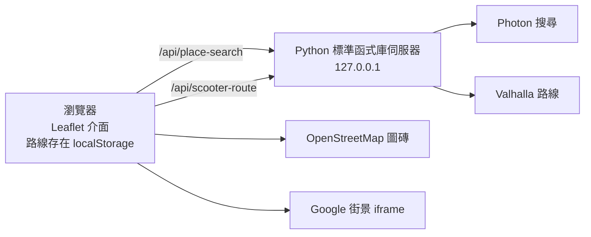

# 路線規劃工作台（Route Workbench）

在同一個畫面看地圖、Google 街景與逐步騎乘說明，沿實際道路規劃機車路線，並保存在自己的瀏覽器。


## 功能

- 搜尋地點（Photon / OpenStreetMap），設定起點、終點與途經點
- 沿道路計算機車路線（Valhalla），顯示公里、模型估時與逐步轉向說明
- 點地圖或步驟，右側切換對應的 Google 街景
- 拖動途經點或路線調整走法；確認後才覆蓋已保存方案
- 路線庫：已儲存／草稿／封存，備份匯出與還原
- 產生 Google Maps 導航連結與可貼到 LINE 的文字

## 架構



伺服器不保存使用者路線，也不記錄搜尋字串或座標；只代理搜尋與路線計算，並做來源檢查、CSRF 權杖、輸入大小與頻率限制。

## 快速開始

需要 Python 3.11 以上，不需安裝套件或 API 金鑰。

```bash
python serve_product_v25.py --port 8789
```

開啟 http://127.0.0.1:8789/ 。資料夾內的 `PUBLIC_ONLY` 會強制公開模式（瀏覽器保存，沒有伺服器端路線庫）。

## 安全設計

| 防護 | 做法 |
|---|---|
| DNS rebinding | 只接受允許的 Host |
| 跨站請求 | 檢查 Origin 與 `Sec-Fetch-Site`，寫入類 API 需 CSRF 權杖 |
| 濫用 | 每個用戶 IP 每分鐘最多 30 次位置服務請求；請求大小上限 |
| 靜態檔案 | 只提供頁面與 `assets/`；原始碼、測試、說明文件一律 404 |
| 瀏覽器 | CSP、`X-Frame-Options`、`nosniff`、停用相機／麥克風／定位權限 |
| 隱私 | 傳送位置給第三方服務前需使用者同意 |

## 已知限制

- **街景**使用 Google 舊式嵌入網址（`output=svembed`），不是 Google Maps Platform 正式的 Embed API，可能隨時失效。公開部署前應改用官方 API（需計費帳戶）或移除街景。
- **第三方公用服務**（OSM 圖磚、Photon 示範伺服器、Valhalla FOSSGIS）只允許低流量使用；正式上線需自架或改用付費供應商。
- 路線計算同一時間只處理一位使用者，其他請求會收到 429。
- 起點、途經點與終點會吸附到 100 公尺內可騎機車的道路；徒步區、公園或大型建物中央（例如巴黎羅浮宮中庭）附近沒有車道時，會提示把點移到車道上。
- 路線超過約 1,000 個道路節點（約 50 公里以上）或直線合計超過 250 公里時，會提示加途經點分段。
- **搜尋**使用 Photon（OpenStreetMap），並以「附近多筆結果互相佐證」重新排序、自動嘗試台／臺異體字，以及把查無門牌的中文／日文地址退回街道層級（標示「近似結果」）。仍有資料缺口：例如「Big Ben」在 OpenStreetMap 名為 Elizabeth Tower，搜尋不到倫敦的鐘塔；日本門牌地址大多只能找到町名。
- **街景**只在 Google 有拍攝的附近位置顯示；偏遠農田、山區會出現「無法產生街景服務圖像」，可按「街景有問題」改在 Google 地圖查看最近的街景。
- 估時是道路模型，不含尖峰車流、紅燈與兩段式待轉。
- Google 導航連結含最多 8 個中途點；手機瀏覽器只支援 3 個，請用 Google Maps App 開啟。

## 部署前

1. 透過反向代理（reverse proxy）提供 HTTPS，啟動時加 `--origin https://你的網域`；若代理在本機，再加 `--trusted-proxy 127.0.0.1` 並由代理覆寫 `X-Real-IP`。
2. 設定 `PLANNER_CLIENT_ID` 讓 Valhalla 識別你的部署；可用 `PLANNER_TILE_URL`、`PLANNER_TILE_ATTRIBUTION`、`PLANNER_TILE_ATTRIBUTION_URL` 更換圖磚供應商。
3. 補上隱私說明：分享的導航連結與備份檔都包含位置。

## 測試與發布檢查

```bash
python tests/test_public.py              # 12 項：HTTP 邊界、公開模式、內建資料、完整性、隱私
python tools/check_privacy.py            # 推送前掃描個資；個人詞彙放在 .privacy-blocklist.txt（不納入版控）
python tools/release_manifest.py --check # 確認 MANIFEST.json 與資產版本號是最新
```

修改 `assets/` 後執行 `python tools/release_manifest.py` 更新版本號與 MANIFEST。

## 授權

本專案程式碼採 [MIT License](LICENSE)。`assets/script-0.js` 為 Leaflet 1.9.4（BSD 2-Clause），第三方授權與服務條款見 [THIRD_PARTY_NOTICES.md](THIRD_PARTY_NOTICES.md)。地圖資料 © OpenStreetMap contributors。
