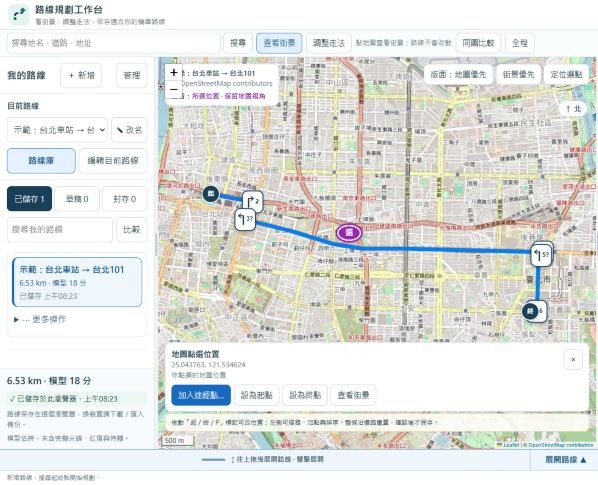

# 路線規劃工作台（Route Workbench）

在同一個畫面看地圖、Google 街景與逐步路線說明，沿實際道路規劃**機車、汽車、自行車或步行**路線，並保存在自己的瀏覽器。



## 可以做什麼

- 搜尋地點或輸入「緯度,經度」，設定起點、終點與途經點
- 選擇交通方式：機車、機車（低速輕型）、汽車、自行車、步行
- 沿實際道路計算路線，顯示公里、預估時間與每一個轉彎
- 點地圖或任一步驟，右側就顯示那裡的 Google 街景
- 拖動途經點或路線來調整走法，確認後才覆蓋原本的路線
- 路線庫分「已儲存／草稿／封存」，可匯出備份、換電腦還原
- 一鍵產生 Google Maps 導航連結，以及可以貼到 LINE 的路線文字

## 開始使用

需要 Python 3.11 以上，不用安裝其他套件，也不需要任何 API 金鑰。

```bash
python serve_product_v25.py --port 8789
```

用瀏覽器開啟 http://127.0.0.1:8789/ 。第一次搜尋或計算路線時，會請你同意把位置資料傳給地點與路線服務。

## 使用時要知道的事

- **時間是估計值**：以道路模型計算，不含尖峰車流與紅燈；機車路線也不含兩段式待轉的等待時間。
- **起點、終點要在路邊**：點會自動吸附到 100 公尺內可通行的道路。若選在徒步區、公園或大型建物中央，會提示你把點移到路上。
- **長途要分段**：超過約 50 公里，或起終點直線距離超過 250 公里時，請加途經點分段規劃。
- **搜尋**使用 OpenStreetMap 資料。找不到門牌時會列出同名街道，並標示「近似結果」；少數地點名稱與 Google 不同，例如倫敦的「Big Ben」在地圖資料裡叫 Elizabeth Tower。
- **街景**只會出現在 Google 拍過的地方。偏遠地區若顯示「無法產生街景服務圖像」，可以按「街景有問題」改到 Google 地圖查看。
- **手機導航**：導航連結包含多個中途點，請用 Google Maps App 開啟；手機瀏覽器只會保留 3 個中途點。
- **現場為準**：禁行、轉向、單行道與待轉規定，請依現場標誌。

## 你的資料

- 路線只存在你自己的瀏覽器，伺服器不保存路線，也不記錄搜尋內容或座標。
- 搜尋文字會送到 Photon，路線的起點、途經點、終點會送到 Valhalla；地圖底圖與街景分別由 OpenStreetMap 和 Google 提供。
- 清除瀏覽器資料會刪除路線，請定期用「管理 → 匯出」備份。

## 進一步文件

- [自行架站說明](docs/DEPLOYMENT.md)：HTTPS、反向代理、環境變數，以及第三方服務的使用限制
- [開發與維護](docs/DEVELOPMENT.md)：架構、安全設計、測試與發布檢查

## 授權

本專案程式碼採 [MIT License](LICENSE)。`assets/script-0.js` 為 Leaflet 1.9.4（BSD 2-Clause）；第三方授權與服務條款見 [THIRD_PARTY_NOTICES.md](THIRD_PARTY_NOTICES.md)。地圖資料 © OpenStreetMap contributors。
