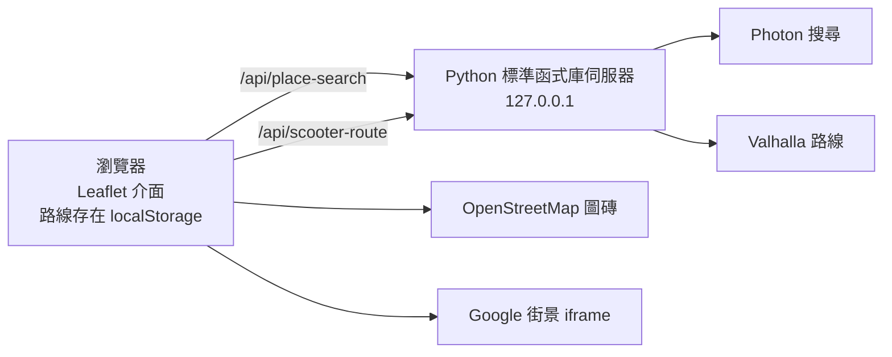

# 開發與維護

## 架構



| 檔案 | 責任 |
|---|---|
| `serve_product_v25.py` | HTTP 伺服器：靜態檔案、API、來源與 CSRF 檢查、頻率限制 |
| `planner_routing_v12.py` | 呼叫 Valhalla；交通方式設定（`MODES`）、道路吸附、步驟文字與錯誤訊息 |
| `planner_search_v14.py` | 呼叫 Photon；候選排序、台／臺異體字重試、門牌查無時退回街道 |
| `planner_store_v10.py` | 路線庫格式驗證（公開模式不使用伺服器端儲存） |
| `index.html`、`assets/` | 前端介面；`script-0.js` 為 Leaflet 1.9.4 |

交通方式對應：

| 介面選項 | Valhalla costing | Google 導航 travelmode |
|---|---|---|
| 機車 | `motorcycle` | `two-wheeler` |
| 機車（低速輕型） | `motor_scooter` | `two-wheeler` |
| 汽車 | `auto` | `driving` |
| 自行車 | `bicycle` | `bicycling` |
| 步行 | `pedestrian` | `walking` |

機車模式另外排除快速道路，並在左轉與迴轉步驟提醒兩段式待轉。

## 安全設計

| 防護 | 做法 |
|---|---|
| DNS rebinding | 只接受允許的 Host |
| 跨站請求 | 檢查 Origin 與 `Sec-Fetch-Site`，寫入類 API 需 CSRF 權杖 |
| 濫用 | 每個用戶 IP 每分鐘最多 30 次位置服務請求；請求大小上限 |
| 靜態檔案 | 只提供頁面與 `assets/`；原始碼、測試、說明文件一律 404 |
| 瀏覽器 | CSP 只允許本站程式與本站 API、`X-Frame-Options`、`nosniff`、停用相機／麥克風／定位權限 |
| 隱私 | 傳送位置給第三方服務前需使用者同意 |
| 費用 | 不使用任何 API 金鑰，也不呼叫付費 API |

## 測試與發布檢查

```bash
python tests/test_public.py          # HTTP 邊界、公開模式、內建資料、完整性、隱私
python tests/test_search_routing.py  # 搜尋排序、異體字、門牌退回、路線錯誤訊息
python tests/test_travel_modes.py    # 五種交通方式：參數、Valhalla 回應檢查、機車專屬規則、儲存
python tools/check_privacy.py        # 推送前掃描個資
python tools/release_manifest.py --check
```

- 修改 `assets/` 或任何檔案後，執行 `python tools/release_manifest.py` 更新資產版本號與 `MANIFEST.json`。
- `tools/check_privacy.py` 會讀取 `.privacy-blocklist.txt`（每行一個不能公開的詞，已列入 `.gitignore`，不會被提交）。
- 文字檔一律以 LF 換行（`.gitattributes`），確保任何平台下載後 MANIFEST 雜湊都一致。
